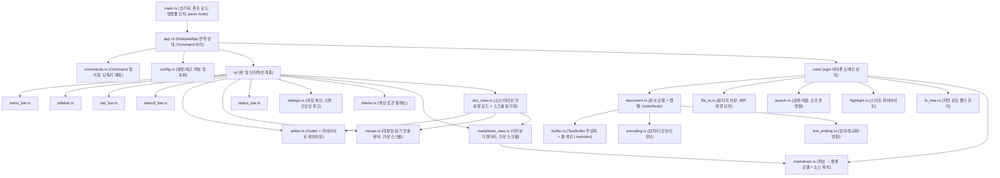

# My-Notepad 프로젝트 기획 및 아키텍처 설계서

> **개정 이력**
> - v0.1 — 초안
> - v0.2 (2026-10-20) — 검토 결과 반영: Phase 0 기술 검증(스파이크) 추가, 성능 목표 수치를 측정 기반으로 조정, 누락 기능(Undo/Redo, 종료 시 저장 확인, 외부 변경 감지 등) 보강, 인코딩/줄바꿈 정책 상세화, 아키텍처를 `core`(UI 비의존) / `ui` 계층으로 분리, 배포·테스트 등 비기능 요구사항 추가
> - v0.3 (2026-10-20) — Markdown 소스 보기 / 미리보기를 핵심 기능으로 추가(§3.8): 소스·미리보기·분할 모드, 양방향 스크롤 동기화, GFM 렌더링 범위, 링크·이미지 정책. 렌더러 방식 결정(§2.5), Phase 0 검증 항목 및 Phase 3(Markdown) 신설에 따라 이후 Phase 번호 하나씩 뒤로 이동
> - v0.4 (2026-10-22) — Phase 5에 탐색기 우클릭 메뉴 "My-Notepad로 편집" 추가 (사용자 요청, P1-13 검증 중)

---

## 1. 프로젝트 개요

### 1.1 배경 및 목적
윈도우 기본 메모장(Notepad)보다 강력한 에디터 기능을 제공하면서도, Electron 기반 에디터(VS Code 등)와 달리 **가벼운 메모리 점유율과 빠른 기동 속도**를 가지는 **Notepad++ 스타일의 로컬 설치형 텍스트 에디터**를 구현한다.

### 1.2 핵심 목표
- **크로스 플랫폼 지원**: Windows 및 macOS 네이티브 동작 (웹 서버/클라우드 불필요, 단일 로컬 실행 프로그램)
- **경량 리소스**: 웹뷰(WebView)를 배제한 **순수 Rust 네이티브 GUI** 기반 (수치 목표는 §1.3)
- **빠른 반응성**: 체감 즉시 기동, 즉각적인 파일 열기 및 텍스트 검색
- **실용적인 에디터 기능**: 멀티 탭, 파일 탐색 사이드바, 정규식 찾기/바꾸기, 선택 단어 일괄 하이라이트, 한글 레거시 인코딩(EUC-KR/CP949) 대응
- **한글 입력 품질**: Windows/macOS 한글 IME 조합 입력이 기본 메모장 수준으로 자연스럽게 동작할 것 (본 프로젝트의 최우선 품질 기준)
- **Markdown 소스 보기 / 미리보기**: `.md` 파일을 소스·미리보기·분할 모드로 자연스럽게 오가며 편집 (스크롤 동기화, 실시간 반영) — 핵심 차별 기능 (§3.8)

### 1.3 성능 목표 (측정 기준 명시)
> GPU 기반 즉시 모드 GUI는 그래픽 컨텍스트·폰트 아틀라스·드라이버 메모리를 포함하므로 초안의 "15~40MB / 0.1초"는 달성 근거가 없었다. 아래 수치는 **Phase 0 실측(2026-10-20, Windows, glow)을 반영해 확정한 목표**다 (P0-10 사용자 승인, 2026-10-20). 측정 상세: [measurements/phase0.md](measurements/phase0.md)

| 항목 | 측정 조건 | 목표 | Phase 0 실측 | 비고 |
| :--- | :--- | :--- | :--- | :--- |
| 메모리 (빈 문서) | 릴리스 빌드, 창 1개, 빈 탭 1개, Working Set(Win) / RSS(mac) | **≤ 120MB** (초안 60MB) | glow 112MB · wgpu 319MB | **렌더러 glow 채택**. 그래픽 드라이버 몫이 커서 60MB는 비현실적 |
| 메모리 (10MB 파일) | 10MB UTF-8 텍스트 1개 열람 | **≤ 150MB** (읽기 전용 뷰어 기준) | 편집 위젯(A)으로 열면 약 1.9GB | ADR 0001: 5MB 초과는 뷰어로 열어 이 목표를 지킨다 (Phase 1에서 측정) |
| 기동 시간 (warm) | 실행 → 첫 프레임 표시 | **≤ 400ms** (초안 300ms) | 수동 241ms · 자동 반복 평균 362ms | 한글 폰트 로드 포함 |
| 기동 시간 (cold) | 재부팅 직후 첫 실행 | **≤ 800ms** | 417ms | 충족 |
| 입력 지연 | **1MB 이하** 파일 편집 중 키 입력 → 화면 반영 | **≤ 16ms (60fps)** | 1MB 7.9ms · 5MB 52ms | ADR 0001: 1~5MB는 느림 안내, 5MB 초과는 뷰어 |
| 검색 | 10MB 파일 전체 정규식 매치 카운트 | **≤ 200ms** | (Phase 4 측정) | UI 블로킹 없이 |
| Markdown 미리보기 갱신 | 100KB `.md` 편집 후 → 미리보기 반영 | **≤ 디바운스 + 50ms** | (Phase 3 측정) | 파싱 + 변경 블록 레이아웃 |
| Markdown 미리보기 스크롤 | 1MB `.md`, 표·코드 블록 포함 | **60fps 유지** | 가상 스크롤 1.4ms (전체 그리기 26ms) · **본 앱 평균 0.76ms·최대 2.0ms** (P3-05) | 보이는 블록만 렌더링 (P0-09), 블록 높이 캐시, 1MB 초과는 백그라운드 파싱 |
| 보기 모드 전환 | 소스 ↔ 미리보기 ↔ 분할 | **≤ 100ms**, 위치 유지 | 100KB 최대 26.0ms (P3-06) | 캐시된 파싱 결과 재사용 |
| 실행 파일 크기 | 릴리스 + strip + LTO | **≤ 15MB** | 스파이크 13.9MB (glow+wgpu, 아이콘 폰트 +0.47MB 별도) | glow만 넣으면 더 줄어듦 |

### 1.4 범위 밖 (Non-Goals)
- 플러그인 시스템, 매크로, 멀티 커서/컬럼 편집, 원격(SSH) 파일 편집, 인쇄
- Linux 공식 지원 (빌드는 가능하도록 유지하되 QA 대상 아님)
- MVP 단계의 5MB 초과 파일 **편집** (5MB 초과는 읽기 전용 뷰어로 열람, §3.6·ADR 0001. 큰 파일 편집은 방식 B로 별도 단계)

---

## 2. 기술 스택 선정

### 2.1 UI 프레임워크 선정 결과
웹뷰를 사용하지 않는 순수 Rust GUI 중, 텍스트 내 특정 구간의 배경색 하이라이트(검색 매치, 동일 단어 강조)와 다중 패널(사이드바, 탭, 상태바) 구성이 가장 유연한 **`eframe` (`egui`)**를 채택한다.

| 구분 | 채택 기술 (`eframe` / `egui`) | 선정 사유 |
| :--- | :--- | :--- |
| **렌더링 방식** | GPU 가속 즉시 모드(Immediate Mode) 네이티브 렌더링 | OS 웹뷰 오버헤드 제거 |
| **텍스트 커스텀 렌더링** | `egui::text::LayoutJob` | 검색 결과 하이라이트, 선택 단어 일괄 강조(배경색 지정) 제어 용이 |
| **패널 및 레이아웃** | `SidePanel`, `TopBottomPanel`, `CentralPanel` | 좌측 파일 트리, 상단 탭/검색바, 하단 상태 표시줄 구성 직관적 |
| **폰트** | 시스템 고정폭 + 한글 폰트를 Fallback 체인으로 등록 (§2.4) | Windows(Consolas + 맑은 고딕), macOS(Menlo + Apple SD 산돌고딕 Neo) |

**egui 채택에 따른 알려진 리스크 (Phase 0에서 반드시 검증)**
1. **한글 IME 조합 입력**: egui/winit의 IME 처리는 버전별 동작 차이가 크며, 조합 중 문자 표시·마지막 글자 중복/유실(Enter/Space 입력 시)·조합 중 Backspace 문제가 보고된 이력이 있다.
2. **`TextEdit`의 대용량 텍스트 성능**: `TextEdit`은 매 프레임 전체 텍스트를 레이아웃(galley)하므로 수 MB 이상에서 입력 지연이 급증한다. 또한 `TextEdit`은 연속된 `&str`을 요구하므로 **Rope 버퍼(`ropey`)와 그대로 결합할 수 없다**.
3. **API 변경 빈도**: egui는 마이너 버전마다 Breaking Change가 잦다 → **버전을 고정**(`Cargo.lock` 커밋)하고 업그레이드는 별도 작업으로 계획한다.

### 2.2 에디터 위젯 구현 방식 (Phase 0에서 ADR로 확정)

| 방식 | 내용 | 장점 | 단점 |
| :--- | :--- | :--- | :--- |
| **A. `TextEdit` + `String`** | egui 기본 위젯에 커스텀 layouter로 하이라이트 | 커서·선택·클립보드·IME를 egui가 처리, MVP 빠름 | 대용량 파일 불가(수 MB 한계), Undo 제어 제한 |
| **B. 자체 에디터 위젯 + `ropey`** | 화면에 보이는 줄만 레이아웃(가상 스크롤) | 대용량 파일, Undo/커서 완전 제어 | 커서·선택·IME·클립보드·스크롤을 전부 직접 구현 (공수 큼) |

**결정 (P0-10 승인, 2026-10-20)**: [ADR 0001](adr/0001-editor-widget.md) — A로 시작하고 5MB 초과는 읽기 전용 뷰어, 큰 파일 편집(B)은 별도 단계. (원래 권장안: MVP는 **A**로 시작하되, 문서 버퍼를 `core::buffer::TextBuffer` 추상화 뒤에 숨겨 **B로 교체 가능한 구조**로 설계한다. 대용량 파일 지원(Phase 6)은 B 전환을 전제로 한다. Phase 0 결과 A의 IME 품질이 불합격이면 egui 이외 프레임워크(iced, Slint 등) 재검토를 포함한 No-Go 판단을 한다.)

### 2.3 핵심 크레이트(Crate) 구성

| 역할 | 크레이트 | 상세 용도 | 도입 시점 |
| :--- | :--- | :--- | :--- |
| **GUI 프레임워크** | `eframe`, `egui` (버전 고정) | 크로스 플랫폼 창 관리 및 UI 렌더링, `persistence` 기능으로 설정 저장 | Phase 0 |
| **네이티브 파일 대화상자** | `rfd` | Windows / macOS 표준 파일 열기, 저장, 폴더 선택 창 호출 | Phase 1 |
| **인코딩 변환** | `encoding_rs` | EUC-KR(CP949) 등 레거시 인코딩 디코딩/인코딩 (UTF-16 **인코딩**은 미지원 → 직접 구현, §3.3) | Phase 1 |
| **인코딩 감지** | `chardetng` | BOM이 없고 UTF-8이 아닌 파일의 레거시 인코딩 추정 (UTF-16 감지 불가 → 별도 휴리스틱) | Phase 1 |
| **원자적 저장** | `tempfile` | 임시 파일에 쓰고 rename 하여 저장 중 크래시 시 원본 손상 방지 | Phase 1 |
| **로깅** | `log`, `simplelog`(또는 동급) | 파일 로그, panic 정보 기록 | Phase 1 |
| **Markdown 파서** | `pulldown-cmark` | CommonMark + GFM(표, 작업 목록, 취소선, 각주, Front Matter) 파싱, **소스 위치(`into_offset_iter`)** 제공 → 스크롤 동기화의 기반 | Phase 3 |
| **이미지 디코딩** | `egui_extras` 이미지 로더 + `image`(png/jpeg/gif 기능만), `resvg`(SVG, 선택) | 미리보기의 로컬 이미지 표시. 필요한 포맷 기능만 켜서 바이너리 크기 억제 | Phase 3 |
| **단어 경계** | `unicode-segmentation` | 스마트 하이라이트/단어 단위 검색의 유니코드 단어 경계 판단 | Phase 2 |
| **gitignore 판정** | `ignore` | 사이드바에서 `.gitignore` 규칙에 걸리는 항목을 흐리게 표시 (§3.1-3) | Phase 2 |
| **파일 아이콘** | (추가 크레이트 없음) | P0-UX2에서 A안 채택: Phosphor 아이콘 폰트(MIT, `assets/file-icons/phosphor`)를 별도 폰트 패밀리로 등록. B안의 `egui_extras` SVG 렌더러는 쓰지 않음 | Phase 2 |
| **정규식 검색 엔진** | `regex` | 정규식 및 일반 문자열 검색, 치환, 매치 오프셋 추출 (전후방 탐색·역참조 미지원, §3.2) | Phase 4 |
| **텍스트 버퍼 (B안)** | `ropey` | Rope 자료구조 기반 텍스트 관리 — **방식 B 전환 시에만 도입** | Phase 6 |
| **구문 강조 (확장)** | `syntect` | 문법 하이라이팅. 바이너리 크기·기동 시간 증가 요인 → 문법 정의 지연 로드 필수 | Phase 6 |

### 2.4 폰트 정책
- **Fallback 체인**: `Monospace` 패밀리 = [영문 고정폭 폰트, 한글 폰트] 순서로 등록하여 영문은 고정폭, 한글은 한글 폰트로 렌더링.
- **Proportional 패밀리**(메뉴·대화상자·**Markdown 미리보기 본문**)에도 한글 폰트를 Fallback으로 등록한다. 미리보기의 굵게/기울임은 굵은 폰트 파일(예: `malgunbd.ttf`)을 별도 패밀리로 등록하여 표현한다 (egui는 가짜 굵게 렌더링을 하지 않음).
- **로드 경로**
  - Windows: `%WINDIR%\Fonts\consola.ttf`, `%WINDIR%\Fonts\malgun.ttf`
  - macOS: `/System/Library/Fonts/Menlo.ttc`, `/System/Library/Fonts/AppleSDGothicNeo.ttc` (`.ttc`는 컬렉션이므로 `FontData`의 face index 지정 필요)
- **로드 실패 시**: egui 기본 폰트로 기동하고 상태 표시줄/로그에 경고 (한글이 □로 표시되는 상황을 사용자에게 알림).
- **결정 (P0-02, 2026-10-20)**: 위 체인을 **직접 구성**하는 방식을 채택한다. 시스템 폰트 파일은 memory-map으로 읽고, `.ttc`는 이름 테이블로 face를 고른다. egui 0.37에 내장된 시스템 폰트 자동 대체(`NativeOptions::system_font_fallback`)는 체인에 없는 문자(일본어·이모지 등)를 위한 **보조 수단으로만** 켜 둔다.
- **라이선스**: 맑은 고딕·Apple SD 산돌고딕은 **번들 재배포 불가** → 시스템 폰트를 런타임 로드만 한다. 일관된 렌더링이 필요하면 OFL 라이선스 폰트(예: D2Coding)를 선택적 번들(빌드 feature)로 제공한다.
- **폭 처리**: 한글은 전각(2칸) 폭이므로 상태 표시줄의 `Col`은 **문자 단위**로 표시하고, 표시 폭 기반 정렬이 필요한 기능(탭 크기 등)은 `unicode-width` 기준으로 계산한다.
- 한글 폰트 파일은 수 MB 이상이므로 Phase 0에서 **기동 시간·메모리 영향**을 측정한다.

### 2.5 Markdown 렌더러 구현 방식 (Phase 0에서 ADR로 확정)

| 방식 | 내용 | 장점 | 단점 |
| :--- | :--- | :--- | :--- |
| **A. `egui_commonmark` 사용** | 기존 egui용 Markdown 뷰어 크레이트 | 빠른 구현, 표·코드 블록·이미지 기본 지원 | egui 버전에 강하게 종속(업그레이드 지연 가능), **블록별 소스 위치·y좌표를 얻기 어려워 스크롤 동기화가 제한적**, 가상 스크롤·한글 굵게 등 세부 제어 어려움 |
| **B. `pulldown-cmark` + 자체 렌더러** | 파싱 결과를 블록 모델로 변환해 직접 egui로 그림 | 소스 위치 ↔ 블록 위치 대응, 가상 스크롤, 더블클릭 이동, 테마·폰트 완전 제어 | 표·목록·인용 등 렌더링 직접 구현 (공수 중간) |

**결정 (P0-08, 2026-10-20)**: **B 채택.** A(egui_commonmark 0.26)는 블록 위치를 공개하지 않아 스크롤 동기화에 쓸 수 없다. 화면 모양은 사용자 비교 결과(UX-004)에 따라 A의 규칙(제목 단계 크기·진한 색 강조·여백·표 틀)을 따른다. — 원래 권장안: §3.8의 "자연스러운 전환과 스크롤 동기화"가 핵심 요구사항이므로 **B를 기본**으로 한다. Phase 0에서 A로 동기화 요구를 충족할 수 있는지 확인하고, 불가하면 B로 확정한다. 어느 쪽이든 파싱 결과는 `core::markdown`의 **블록 모델(블록 종류 + 소스 줄 범위 + 인라인 스팬)**로 변환하여 UI와 분리한다.

---

## 3. 핵심 기능 명세

### 3.1 멀티 탭(Multi-Tab) 및 파일 탐색 사이드바
1. **멀티 탭 문서 관리**
   - 여러 개의 텍스트 파일 및 새 문서(`Untitled-N`)를 동시에 탭으로 열어 전환
   - 수정된 문서 상태 표시(`●` 마커), 탭 툴팁에 전체 경로 표시
   - 저장하지 않은 탭 닫기 시 확인 대화상자 (`저장` / `저장 안 함` / `취소`)
   - **앱 종료(창 닫기 버튼, `Cmd+Q`) 시**에도 수정된 모든 문서에 대해 확인 (eframe의 close 요청을 가로채 취소 가능해야 함)
   - 이미 열린 파일을 다시 열면 새 탭을 만들지 않고 해당 탭으로 포커스 (경로는 정규화하여 비교)
   - 탭별 독립 상태 유지: 커서 위치, 스크롤 위치, Undo 이력
   - **탭이 창 폭을 넘칠 때 (UX-002 결정)**: 한 줄을 유지하고 다음을 제공한다
     - 선택한 탭은 어떤 경로로 바뀌든(클릭·`Ctrl+Tab`·사이드바·목록) **항상 화면 안으로 자동 스크롤**
     - 넘칠 때만 탭 바 양 끝에 `‹` `›` 버튼 표시 (끝에 닿으면 비활성), 마우스 휠(세로)로도 가로 스크롤
     - 오른쪽 끝 `⌄` 버튼: **열린 탭 전체 목록** 드롭다운 (이름 검색, 수정 표시 `●`, 선택 시 해당 탭으로 이동)
     - `＋`(새 탭)·`⌄`는 스크롤 영역 밖에 고정해 항상 보이게 한다
   - **창 메뉴 (UX-003, `도움말` 왼쪽)**: 창 관리 기능을 한곳에 모은다
     - 다음 탭 · 이전 탭 · 탭을 왼쪽/오른쪽으로 이동 (단축키는 §3.5)
     - 탭 닫기 · 다른 탭 모두 닫기 · 오른쪽 탭 모두 닫기 · 저장된 탭 닫기 · 모든 탭 닫기
     - **창 목록…** 대화상자: 열린 문서를 표로 보여 주고(아이콘·이름·수정 여부·경로) 체크해서 **선택한 창 닫기**, **모든 창 닫기**, 더블클릭·`이동`으로 해당 창으로 전환
     - 메뉴 아래쪽에 열린 탭 바로가기 목록 (번호, `Ctrl+1`~`8`·`Ctrl+9` 표시, 현재 탭 강조, 수정된 탭 색 표시)
   - **탭 우클릭 메뉴**: 닫기 · 다른 탭 모두 닫기 · 오른쪽 탭 모두 닫기 · 저장된 탭 닫기 · 모든 탭 닫기 · 경로 복사
   - **여러 탭 일괄 닫기**: 닫을 탭을 대기열에 넣고 하나씩 처리한다. 수정된 탭마다 저장 확인을 받으며(남은 개수 안내), `취소`·`Esc`를 누르면 남은 일괄 닫기도 모두 멈춘다
2. **파일 탐색 사이드바 (Folder Explorer)**
   - 좌측 접기/펴기 가능한 폴더 트리 패널 제공 — 메뉴(`보기 → 사이드바`)·단축키(`Ctrl/Cmd+B`)뿐 아니라 **화면에서 직접**: 사이드바 머리글의 `«` 버튼으로 닫고, 닫힌 상태에서 왼쪽 가장자리에 남는 좁은 띠(`»` 버튼, 띠 어디를 클릭해도 열림)로 다시 연다
   - 로컬 폴더 열기 시 하위 디렉토리 및 파일 목록을 트리 형태로 표시
   - **지연 로딩**: 폴더를 펼칠 때 해당 단계만 읽음 (대형 폴더에서 UI 멈춤 방지)
   - 기본 숨김 목록: `.git`, `node_modules`, `.svn`, `.hg`, `.DS_Store`, `Thumbs.db` (gitignore 문법, 설정 가능), 심볼릭 링크 순환 방지. `target` 같은 빌드 산출물은 숨기지 않고 `.gitignore` 규칙으로 흐리게 표시한다 (§3.1-3, P2-05 결정)
   - 파일 클릭 시 새 탭으로 열거나 이미 열려 있는 탭으로 즉시 포커스 이동
   - 수동 새로고침 버튼 제공 (실시간 파일 시스템 감시는 범위 밖)
3. **파일·폴더 아이콘** (VS Code 탐색기 수준의 식별성)
   - **결정 순서**: ① 파일 이름 정확히 일치(`Cargo.toml`, `Cargo.lock`, `.gitignore`, `.gitattributes`, `.editorconfig`, `README.md`, `rust-toolchain.toml` 등) → ② 확장자(`.rs`, `.md`, `.toml`, `.json`, `.txt`, `.log`, `.exe`, `.pdb` 등) → ③ 기본 파일 아이콘
   - **폴더**: 이름별 아이콘(`src`, `docs`, `tests`, `target`, `.cargo`, `.git` 등) + **열림/닫힘 상태를 다른 아이콘으로** 구분, 해당 없으면 기본 폴더 아이콘
   - **무시된 항목 흐리게 표시**: 열린 폴더의 `.gitignore` 규칙에 걸리는 파일·폴더(예: `target/`)는 숨기지 않고 흐린 색으로 표시 (숨김 목록 §3.1-2와 별개로, 숨김 대상은 여전히 숨김)
   - **탭 바에도 같은 아이콘**을 표시해 사이드바와 일관성 유지
   - **아이콘 묶음**: 자주 쓰는 30~50개만 선별해 내장. 매핑 표(이름/확장자 → 아이콘)는 코드가 아닌 데이터 파일로 관리해 추가가 쉽도록 한다
   - **구현 방식 — 결정 (P0-UX2, 2026-10-20)**: **A. 단색 아이콘 폰트(Phosphor) + 파일 종류별 색**. 가볍고(실행 파일 약 +0.47MB) 라이트/다크 테마 대응이 쉽다. 비교한 B안(Material 다색 SVG, 약 +1.06MB)은 채택하지 않았고, 사용자가 바꾸는 설정으로도 두지 않는다 (아이콘 방식은 하나만 유지)
   - **라이선스**: 외부 아이콘 묶음은 도입 전 라이선스를 확인하고 `assets/file-icons/LICENSE`와 정보 대화상자에 출처를 표기한다

### 3.2 찾기/바꾸기 및 단어 일괄 하이라이트
1. **선택 단어 일괄 하이라이트 (Smart Highlighting)**
   - **트리거**: 선택 영역이 바뀔 때만 재계산 (매 프레임 계산 금지)
   - **조건**: 한 줄 내 선택, 앞뒤 공백 제거 후 2글자 이상, 내부에 공백 없음
   - **매칭 규칙**: 기본값은 **단어 단위 일치 + 대소문자 구분** (Notepad++ 기본 동작과 동일), 두 옵션 모두 설정에서 변경 가능
     - 한글은 조사가 붙는 특성상 단어 단위 일치 시 `검색`을 선택해도 `검색어`는 매치되지 않음 → 부분 일치 옵션 제공
   - **상한**: 최대 매치 수(예: 10,000개) 초과 시 하이라이트 중단 및 상태 표시줄에 안내
2. **찾기 및 바꾸기 바**
   - **검색 옵션**: 정규식 사용(`.*`), 대소문자 구분(`Aa`), 단어 단위 일치(`\b`), 끝에서 처음으로 이어서 찾기(Wrap Around, 기본 켬)
   - **정규식 문법**: Rust `regex` 문법을 따른다. **전후방 탐색(lookaround)과 역참조는 지원하지 않음**을 UI 도움말에 명시한다 (Notepad++ 사용자 혼란 방지). 잘못된 패턴은 입력창을 빨간색으로 표시하고 오류 메시지 툴팁 제공
   - **실시간 매치 피드백**
     - 입력 후 **디바운스(약 150ms)** 뒤 검색, 대용량 문서는 백그라운드 스레드에서 수행하고 새 입력 시 이전 작업 취소
     - 문서 내 일치하는 모든 구간을 배경색으로 강조하고 현재 매치는 별도 색상으로 구분
     - 매치 카운트 표시 (예: `3 / 28`), 매치 없음 시 `결과 없음`
   - **이동 및 치환**
     - 다음/이전 찾기 및 해당 위치로 자동 스크롤 (단축키는 §3.5)
     - 현재 항목 바꾸기(`Replace`), 전체 일괄 바꾸기(`Replace All`, 바꾼 개수 표시)
     - 치환 문자열 문법: 정규식 모드에서 `$1`, `${name}` 캡처 그룹 및 `\n`, `\t` 이스케이프 지원
     - **`Replace All`은 한 번의 Undo로 되돌릴 수 있어야 함**
   - **오프셋 처리**: `regex`는 바이트 오프셋을, egui 커서는 문자 인덱스를 사용하므로 `core::search`에서 변환을 일원화한다 (한글은 UTF-8에서 3바이트이므로 혼용 시 커서가 어긋남)
   - 선택 영역 내 찾기, 여러 파일에서 찾기(Find in Files)는 2차 목표

### 3.3 인코딩(Encoding) 정책
1. **지원 인코딩**
   - `UTF-8` (새 문서 기본값), `UTF-8 with BOM`
   - `EUC-KR (CP949)` — `encoding_rs`의 `EUC_KR`은 WHATWG 표준에 따라 실제로는 **CP949(windows-949) 상위 집합**으로 동작한다. 따라서 저장 시 확장 완성형 문자가 포함될 수 있으며, UI 표기는 `EUC-KR (CP949)`로 통일한다.
   - `UTF-16 LE` / `UTF-16 BE` (BOM 포함 저장)
2. **열기 시 감지 순서**
   1. **BOM 확인**: `EF BB BF` → UTF-8 BOM, `FF FE` → UTF-16 LE, `FE FF` → UTF-16 BE
   2. **빈 파일** → 설정의 기본 인코딩(UTF-8)
   3. **UTF-8 유효성 검사**: 전체가 유효한 UTF-8이면 UTF-8 (ASCII 전용 파일 포함)
   4. **BOM 없는 UTF-16 휴리스틱**: 짝수/홀수 바이트 위치의 `0x00` 비율로 판정
   5. **바이너리 판정**: 위에 해당하지 않으면서 `0x00` 바이트가 포함되면 바이너리로 간주 → "바이너리 파일입니다. 그래도 여시겠습니까?" 확인
   6. **레거시 추정**: `chardetng`로 추정 (`allow_utf8 = false`). 결과가 지원 목록 밖이면 `EUC-KR (CP949)`로 대체하고 상태 표시줄에 "추정됨" 표시
3. **디코딩 오류 처리**
   - 잘못된 바이트는 대체 문자(`U+FFFD`)로 표시하고, 문서에 **"디코딩 손상"** 상태를 표시한다.
   - 이 상태에서 저장하면 원본 바이트가 영구 손실되므로 저장 전 경고하고 `인코딩으로 다시 읽기`를 안내한다.
4. **인코딩으로 다시 읽기 (Reopen with Encoding)**
   - 디스크의 파일을 지정한 인코딩으로 **다시 읽어** 디코딩한다 (원본 바이트를 메모리에 상주시키지 않음 → 메모리 절약).
   - 문서가 수정된 상태면 "변경 내용을 버리고 다시 읽기" 확인을 받는다. 디스크 파일이 그사이 바뀌었으면 함께 알린다.
5. **인코딩 변환 저장 (Convert to Encoding)**
   - 문서 텍스트는 그대로 두고 저장 시 사용할 인코딩만 변경한다 (문서는 수정됨 상태로 전환).
   - **표현 불가 문자 처리**: `encoding_rs`는 EUC-KR로 표현할 수 없는 문자(이모지, 일부 한자 등)를 **HTML 숫자 참조(`&#128512;`)로 몰래 치환**한다. 반드시 `had_unmappable_characters` 결과를 확인하여, 해당 문자 목록과 위치(첫 N개)를 보여주고 저장을 막거나 사용자가 명시적으로 승인한 경우에만 `?`로 대체하여 저장한다.
   - **UTF-16 인코딩은 `encoding_rs`로 할 수 없다** (`encoding_rs`의 UTF-16 출력 인코딩은 UTF-8로 정의됨) → `str::encode_utf16()`으로 직접 변환하고 엔디언에 맞게 바이트 직렬화, BOM을 직접 기록한다.
   - **UTF-8 BOM**도 `encoding_rs`가 기록하지 않으므로 직접 앞에 붙인다.
6. **회귀 테스트**: `tests/fixtures/encoding/`에 인코딩별 샘플 파일을 두고 "읽기 → 저장 → 바이트 동일" 라운드트립 테스트를 CI에서 수행한다.

### 3.4 줄바꿈(Line Ending) 정책
- **내부 표현은 `LF`로 정규화**하고, 문서별로 저장 시 사용할 줄바꿈 방식을 별도 필드로 보관한다 (편집·검색·정규식 로직 단순화).
- **감지**: 파일 로드 시 `CRLF` / `LF` / `CR`(구형 Mac) 개수를 세어 가장 많은 방식을 채택한다. 둘 이상이 섞여 있으면 상태 표시줄에 `Mixed (CRLF)` 형태로 표시하고, 저장 시 채택된 방식으로 통일됨을 첫 저장 때 1회 알린다.
- **변환**: 상태 표시줄 클릭으로 `CRLF ↔ LF` 전환 → 문서는 수정됨 상태가 되고 저장 시 반영된다.
- **새 문서 기본값**: Windows `CRLF`, macOS `LF` (설정에서 변경 가능).
- **파일 끝 개행**은 원본 상태(있음/없음)를 그대로 보존한다.

### 3.5 에디터 기본 기능 및 단축키
**기본 편집 (MVP 필수)**
- 실행 취소/다시 실행 (`Undo` / `Redo`) — 탭별 독립 이력
- 잘라내기/복사/붙여넣기, 모두 선택
- 줄 이동 (`Go to Line`)
- 자동 줄바꿈(Word Wrap) 켜기/끄기 — 끈 경우 가로 스크롤
- 글꼴 확대/축소/초기화 (`Ctrl + +/-/0`)
- 탭 문자 처리: 탭 너비(기본 4), 탭/공백 입력 방식 설정
- 파일 열기 경로: 메뉴/대화상자, **창으로 드래그 앤 드롭**, **명령줄 인자**(`my-notepad a.txt b.txt`, "연결 프로그램"으로 열기 대응)
- **최근 열어본 파일** 목록 (최대 10개, 설정에 영속화)

**단축키 (OS별 관례 반영)**
> macOS에서 `Cmd+H`는 시스템 "앱 가리기"이며, `F3` 등 기능 키는 기본적으로 `fn`이 필요하므로 macOS 관례 단축키를 별도로 정의한다. egui의 `TextEdit`이 일부 키를 먼저 소비하므로, 전역 단축키는 **위젯보다 먼저 입력 이벤트에서 처리**한다.

| 기능 | Windows | macOS |
| :--- | :--- | :--- |
| 새 탭 | `Ctrl+N` | `Cmd+N` |
| 열기 | `Ctrl+O` | `Cmd+O` |
| 저장 / 다른 이름으로 저장 | `Ctrl+S` / `Ctrl+Shift+S` | `Cmd+S` / `Cmd+Shift+S` |
| 탭 닫기 | `Ctrl+W` | `Cmd+W` |
| 다음 탭 (탭 순서, 끝에서 처음으로) | `Ctrl+Tab`, `Ctrl+PageDown` | `Ctrl+Tab`, `Cmd+Shift+]`, `Cmd+Option+→` |
| 이전 탭 | `Ctrl+Shift+Tab`, `Ctrl+PageUp` | `Ctrl+Shift+Tab`, `Cmd+Shift+[`, `Cmd+Option+←` |
| 1~8번째 탭 / 마지막 탭 | `Ctrl+1`~`Ctrl+8` / `Ctrl+9` | `Cmd+1`~`Cmd+8` / `Cmd+9` |
| 탭을 왼쪽 / 오른쪽으로 이동 | `Ctrl+Shift+PageUp` / `Ctrl+Shift+PageDown` | `Cmd+Shift+Option+←` / `→` |
| 모든 탭 닫기 | `Ctrl+Shift+W` | `Cmd+Shift+W` |
| 실행 취소 / 다시 실행 | `Ctrl+Z` / `Ctrl+Y` | `Cmd+Z` / `Cmd+Shift+Z` |
| 찾기 | `Ctrl+F` | `Cmd+F` |
| 바꾸기 | `Ctrl+H` | `Cmd+Option+F` |
| 다음 찾기 / 이전 찾기 | `F3` (검색창에서 `Enter`) / `Shift+F3` | `Cmd+G` / `Cmd+Shift+G` |
| 줄 이동 | `Ctrl+G` | `Cmd+L` |
| 사이드바 토글 | `Ctrl+B` | `Cmd+B` |
| Markdown 소스 ↔ 미리보기 전환 | `Ctrl+Shift+V` | `Cmd+Shift+V` |
| Markdown 분할 보기 토글 | `Ctrl+K V` (연속 입력) | `Cmd+K V` |
| 스크롤 동기화 켜기/끄기 | 메뉴 전용 | 메뉴 전용 |
| 종료 | `Alt+F4` | `Cmd+Q` |

### 3.6 파일 입출력 안정성
- **원자적 저장**: 같은 폴더의 임시 파일에 쓴 뒤 rename. 실패 시 원본 유지 및 오류 대화상자 표시
- **외부 변경 감지**: 앱이 포커스를 얻을 때 열린 파일의 수정 시각/크기를 확인 → 변경 시 "다시 불러오기" 확인 (수정되지 않은 탭은 자동 리로드 옵션), 파일 삭제 시 탭에 표시
- **읽기 전용/권한 오류**: 읽기 전용 파일은 탭에 자물쇠 표시, 저장 시 "다른 이름으로 저장" 유도
- **대용량 파일 정책 (ADR 0001 결정, P0-06 실측 기반)**: ~1MB 일반 편집 · 1~5MB 편집 허용 + 상단 안내("큰 파일이라 입력이 느릴 수 있습니다 · 읽기 전용으로 보기") · 5MB 초과는 **읽기 전용 뷰어**(보이는 줄만 그림, 줄 번호·선택·복사·찾기·인코딩 표시, "편집 모드로 열기"는 경고 후 허용). 경계값은 설정으로 변경 가능. 큰 파일 편집은 방식 B로 별도 단계에서 지원
- **panic 대비**: panic hook에서 로그를 남기고, 수정된 문서를 백업 폴더에 덤프 시도

### 3.7 상태 표시줄 및 화면 구성
- **줄 번호(Line Number Gutter)**: 본문 스크롤과 동기화. 자동 줄바꿈 켠 경우 **논리 줄 기준**으로 번호를 표시(줄바꿈된 시각적 행에는 번호 없음)하며, 이를 위해 레이아웃 결과(galley)의 행 정보를 사용한다
- **상태 표시줄**
  - 현재 커서 위치 (`Ln X, Col Y`, 문자 단위) 및 선택된 글자 수 (바이트 수는 현재 인코딩 기준으로 계산)
  - 전체 줄 수 및 문서 길이
  - 줄바꿈 방식 (`CRLF` / `LF` / `Mixed`) 표시 및 전환 팝업
  - 문자 인코딩 (`UTF-8`, `EUC-KR (CP949)` 등, 추정·손상 상태 포함) 표시 및 전환 팝업
- **테마**: 라이트/다크 (OS 설정 추종 기본)
- **설정 영속화**: 창 크기·위치, 사이드바 상태, 글꼴 크기, 줄바꿈, 검색 옵션, 최근 파일, 탭별 보기 모드 → 자체 `settings.toml`(`config.rs`, serde + toml, 원자적 저장, 손상 시 기본값 + `settings.bad.toml` 보관). eframe `persistence`는 egui 내부 메모리와 섞이고 손상 처리가 어려워 쓰지 않는다 (P2-08 결정). 검색 옵션·탭별 보기 모드는 해당 기능과 함께 추가

### 3.8 Markdown 소스 보기 / 미리보기 (핵심 기능)
> `.md` 파일은 **소스 편집과 렌더링된 미리보기를 끊김 없이 오가며** 작업할 수 있어야 한다. 웹뷰를 쓰지 않으므로 Markdown을 **egui 위젯으로 직접 렌더링**한다.

1. **대상 파일 및 보기 모드**
   - 대상 확장자: `.md`, `.markdown` (설정에서 추가 가능). 그 외 파일도 `보기` 메뉴에서 수동으로 미리보기 가능
   - 보기 모드 3종: **소스** / **미리보기** / **분할(좌: 소스, 우: 미리보기)**
   - 모드는 **탭별로 유지**되며, 탭 상단 우측 토글 버튼과 단축키(§3.5)로 전환
   - `.md` 파일을 처음 열 때의 기본 모드는 설정 가능 (기본값: **분할**). 창 폭이 좁으면(예: 900px 미만) 분할 대신 소스/미리보기 전환으로 자동 대체
   - 분할 비율은 드래그로 조절하고 설정에 저장
   - 모드 전환 시 **현재 보고 있던 위치(스크롤)와 커서가 유지**되어야 함 — 전환할 때마다 문서 맨 위로 튀는 동작 금지

2. **실시간 반영**
   - 소스 편집 후 **디바운스(약 150~200ms)** 뒤 미리보기 갱신, 입력 중 깜빡임·스크롤 튐 없음
   - 파싱은 문서 버전(수정 카운터)이 바뀔 때만 수행하고 결과(블록 트리)를 캐시, 매 프레임 재파싱 금지
   - 미리보기는 **화면에 보이는 블록만 렌더링**(블록별 높이 캐시 + 가상 스크롤)하여 긴 문서에서도 스크롤이 부드러워야 함
   - 대용량 Markdown(잠정 1MB 초과)은 파싱을 백그라운드 스레드에서 수행, 완료 전에는 이전 결과 유지

3. **스크롤 및 위치 동기화 (분할 모드)**
   - 파서의 **소스 위치 정보(블록별 줄 범위)**를 이용해 "소스 줄 ↔ 미리보기 블록 y좌표" 대응표를 만든다
   - 소스 스크롤 → 미리보기 스크롤, 미리보기 스크롤 → 소스 스크롤 **양방향 동기화** (블록 사이는 선형 보간, 한쪽이 움직이는 동안 반대쪽 이벤트로 되먹임되지 않도록 잠금)
   - 소스에서 커서를 이동하면 미리보기의 해당 블록을 옅은 배경으로 표시
   - 미리보기에서 블록을 **더블클릭하면 소스의 해당 줄로 커서 이동** (소스 모드였다면 분할/소스로 전환)
   - 동기화 켜기/끄기 옵션 제공

4. **렌더링 지원 범위 (CommonMark + GFM)**
   | 요소 | 지원 | 비고 |
   | :--- | :--- | :--- |
   | 제목(H1~H6), 문단, 강조/굵게/취소선, 인용, 수평선 | ✅ | 제목은 크기·굵기 단계 구분 |
   | 순서/비순서 목록, 중첩 목록, **작업 목록**(`- [ ]`) | ✅ | 체크박스는 표시 전용 (클릭 시 소스 수정은 2차 목표) |
   | 인라인 코드, 코드 블록(펜스/들여쓰기) | ✅ | 고정폭 + 배경. 언어별 문법 강조는 `syntect` 도입 후 |
   | **표(GFM Table)** | ✅ | 열 정렬(`:---:`) 반영, 넓은 표는 가로 스크롤 |
   | 링크, 자동 링크 | ✅ | 아래 링크 정책 참조 |
   | 이미지 | ✅ (로컬) | 문서 기준 상대 경로·절대 경로의 PNG/JPEG/GIF(첫 프레임)/SVG. **원격 이미지는 기본 차단**(개인정보·보안), 설정으로 허용 |
   | 각주, 목차 앵커(`#제목`) | ✅ | 제목 앵커는 GitHub 방식 슬러그(한글 포함) |
   | YAML Front Matter | ✅ | 본문 대신 접을 수 있는 메타데이터 블록으로 표시 |
   | 원시 HTML 블록/인라인 | ⚠️ | **실행·렌더링하지 않고** 소스 텍스트 그대로(회색) 표시. `<br>` 정도만 줄바꿈으로 해석 |
   | Mermaid, 수식(KaTeX) | ❌ | 코드 블록으로 표시하고 "미리보기 미지원" 라벨 표시 (2차 목표 검토) |

5. **링크 동작**
   - `http(s)://` 링크: 클릭 시 OS 기본 브라우저로 열기 (주소를 툴팁으로 먼저 보여줌)
   - 상대 경로 `.md` 링크: 앱 내 **새 탭으로 열기**(이미 열려 있으면 포커스), `#앵커`가 있으면 해당 제목으로 스크롤
   - 문서 내 `#앵커`: 미리보기 내 해당 제목으로 스크롤 (분할 모드면 소스도 동기화)
   - 존재하지 않는 대상은 링크를 다른 색으로 표시하고 클릭 시 안내

6. **소스 보기 품질**
   - 소스 모드에서도 가벼운 **Markdown 구문 색상**을 적용: 제목(`#`), 강조, 인라인 코드/코드 블록, 링크, 목록 기호, 인용 (`syntect` 없이 파서의 위치 정보로 처리)
   - 편의 기능(2차 목표): 목록에서 Enter 시 다음 항목 기호 자동 입력, 선택 영역 굵게(`Ctrl/Cmd+B`는 사이드바와 충돌하므로 미할당) 등

7. **미리보기 공통 품질 기준**
   - 한글 본문은 **비례폭(Proportional) 한글 폰트**로 자연스럽게 줄바꿈 (§2.4 Fallback 체인을 Proportional 패밀리에도 적용)
   - 라이트/다크 테마를 따르고 본문 최대 폭 제한(가독성, 예: 860px)
   - 미리보기 텍스트 **선택 및 복사 가능**
   - 미리보기 글꼴 크기는 에디터 확대/축소와 연동
   - 소스와 미리보기 모두에서 찾기(`Ctrl/Cmd+F`) 사용 가능: 미리보기 모드에서 찾으면 매치를 미리보기에 강조(텍스트 블록 대상)

8. **내보내기 (2차 목표)**
   - "HTML로 내보내기": 파서의 HTML 출력 + 기본 CSS를 단일 파일로 저장 (구현 비용이 작아 우선순위 높음)

---

## 4. 시스템 아키텍처 및 디렉토리 구조

### 4.1 설계 원칙
- **`core`는 egui에 의존하지 않는다**: 인코딩, 줄바꿈, 검색, 하이라이트 계산, 파일 I/O, 문서 모델은 순수 Rust 로직으로 작성하여 **단위 테스트 가능**하게 한다.
- **커맨드 패턴**: 메뉴·단축키·버튼은 모두 `Command` 열거형을 발행하고 `app.rs`가 한 곳에서 처리한다 (단축키 중복/누락 방지, 메뉴와 단축키 동작 일치).
- **버퍼 추상화**: `core::buffer::TextBuffer` 트레이트 뒤에 실제 저장소(`String` → 향후 `ropey`)를 숨겨 에디터 방식 전환 비용을 줄인다.
- **무거운 작업은 백그라운드**: 대용량 검색, 폴더 스캔은 작업 스레드에서 수행하고 결과를 채널로 전달, 완료 시 `ctx.request_repaint()`.
- **매 프레임 재계산 금지**: 하이라이트 구간·검색 결과는 문서 버전(수정 카운터)과 검색 조건이 바뀔 때만 다시 계산하여 캐시한다.

### 4.2 모듈 구성도



### 4.3 디렉토리 구조 (저장소: <https://github.com/victoriatech25/my-notepad>)
> 개발 환경(Windows PC + MacBook Pro 병행)과 장비 전환 규칙은 [WORKPLAN.md §0.8](WORKPLAN.md)을 따른다.

```text
my-notepad/
├── Cargo.toml               # 본 앱 패키지 + 워크스페이스(xtask, spikes/*)
├── Cargo.lock               # egui 등 버전 고정을 위해 커밋
├── rust-toolchain.toml      # 두 장비의 Rust 버전·구성요소 일치
├── .gitattributes           # 소스 LF, 테스트 픽스처는 -text(바이트 보존)
├── .gitignore
├── .editorconfig
├── README.md                # 프로젝트 소개, 문서 안내, 개발 환경 준비
├── .cargo/config.toml       # `cargo xtask` 별칭
├── docs/
│   ├── PLAN.md              # 프로젝트 기획 및 설계 문서
│   ├── WORKPLAN.md          # 작업 단위·검증 체크리스트·게이트
│   ├── adr/                 # 아키텍처 결정 기록 (예: 0001-editor-widget.md)
│   ├── ux/                  # ui-spec.md(확정 UI 명세), screens/(화면 스크린샷)
│   └── manual-test.md       # 누적 수동 회귀 테스트 체크리스트
├── xtask/                   # Windows·macOS 공통 개발 보조 명령: `cargo xtask try <시나리오>`(빌드+실행+샘플 열기), `cargo xtask measure`(성능 측정)
├── spikes/                  # Phase 0 실험 프로젝트 (editor-spike, md-spike, ux-prototype)
├── assets/
│   ├── icons/               # 앱 아이콘 (Windows .ico, macOS .icns)
│   └── file-icons/          # 사이드바·탭용 파일/폴더 아이콘, 매핑 표(icons.toml), LICENSE
├── src/
│   ├── main.rs              # 엔트리 포인트, 창 옵션, 폰트 로드, 명령줄 인자, panic hook
│   ├── app.rs               # 앱 루트 상태, Command 디스패치, 레이아웃 조합, 종료 확인
│   ├── commands.rs          # Command 열거형, OS별 단축키 매핑
│   ├── config.rs            # 사용자 설정, 최근 파일 목록
│   ├── fonts.rs             # OS별 폰트 경로 탐색 및 Fallback 체인 구성
│   ├── core/
│   │   ├── mod.rs
│   │   ├── document.rs      # 문서 상태 (경로, 버퍼, 인코딩, 줄바꿈, 수정/손상/읽기전용 플래그, 탭별 Undo/Redo, 디스크 메타데이터)
│   │   ├── buffer.rs        # TextBuffer 트레이트, String 구현체, 줄 시작 위치 색인(LineIndex)
│   │   ├── encoding.rs      # 인코딩 감지, 디코딩, 인코딩(UTF-16/BOM 직접 처리, 표현 불가 문자 검출)
│   │   ├── line_ending.rs   # 줄바꿈 감지(Mixed 포함), LF 정규화, 저장용 변환
│   │   ├── file_io.rs       # 원자적 저장, 외부 변경 감지, 대용량/바이너리 판정
│   │   ├── search.rs        # 정규식/일반 검색, 매치 캐싱, 치환, 바이트↔문자 오프셋 변환
│   │   ├── highlight.rs     # 스마트 하이라이트 대상 판정 및 매치 계산
│   │   ├── fs_tree.rs       # 사이드바 폴더 트리 모델 (지연 로딩, 제외 패턴, .gitignore 판정)
│   │   ├── file_icons.rs    # 파일·폴더 아이콘 결정 규칙 (이름 → 확장자 → 기본, 열림/닫힘 폴더)
│   │   └── markdown.rs      # pulldown-cmark 파싱 → 블록 모델(종류, 소스 줄 범위, 인라인 스팬), 제목 앵커 슬러그, 소스 구문 색상 구간
│   └── ui/
│       ├── mod.rs
│       ├── theme.rs         # docs/ux/ui-spec.md 색상 토큰 팔레트 (라이트/다크)
│       ├── menu_bar.rs      # 파일/편집/검색/보기/인코딩/창/도움말 상단 메뉴
│       ├── sidebar.rs       # 폴더 트리 뷰
│       ├── tab_bar.rs       # 멀티 탭 전환 및 닫기 UI (넘침 스크롤·목록 포함)
│       ├── search_bar.rs    # 찾기/바꾸기 패널 UI
│       ├── editor.rs        # 줄 번호 Gutter + LayoutJob 기반 텍스트/하이라이트 에디터
│       ├── viewer.rs        # 5MB 초과 대용량 읽기 전용 뷰어 (보이는 줄만 렌더링, 선택·복사, ADR 0001)
│       ├── status_bar.rs    # 하단 상태 표시줄 및 인코딩/줄바꿈 빠른 변경 메뉴
│       ├── dialogs.rs       # 모달 대화상자 모음 (저장 확인, 창 목록, 인코딩/대용량 경고 등)
│       ├── doc_view.rs      # 탭 본문 컨테이너: 보기 모드(소스/미리보기/분할), 분할 비율, 양방향 스크롤 동기화
│       └── markdown_view.rs # 블록 모델 렌더링(제목, 목록, 표, 코드, 이미지, 링크), 블록 높이 캐시, 가상 스크롤
└── tests/
    ├── encoding_roundtrip.rs
    ├── line_ending.rs
    ├── search.rs
    ├── markdown.rs          # 블록 모델·소스 위치·앵커 슬러그 테스트
    └── fixtures/
        ├── encoding/        # utf8.txt, utf8_bom.txt, cp949.txt, utf16le.txt, utf16be.txt, mixed_eol.txt, binary.bin ...
        └── markdown/        # gfm_all.md(전체 요소), korean.md, long_1mb.md, links/(상대 경로 링크·이미지)
```

---

## 5. 단계별 개발 로드맵 (Milestones)

> 각 Phase는 **완료 기준(Definition of Done)**을 충족해야 다음 단계로 넘어간다. 작업 단위(WU)·검증 체크리스트·게이트는 [WORKPLAN.md](WORKPLAN.md)에서 관리한다.

### Phase 0: 기술 검증 스파이크 (약 1~2주)

> **Phase 0 완료 (2026-10-20, G0 통과)**: 13개 작업 단위 모두 Windows 검증 통과. 결정 — egui/eframe 0.37.0 고정, **렌더러 glow**, 폰트 직접 구성(§2.4), UI 명세 확정 v1(`docs/ux/ui-spec.md`), 파일 아이콘 Phosphor, 탭 넘침·창 메뉴(§3.1-1), **에디터 방식 ADR 0001**(1MB 편집 · 1~5MB 안내 · 5MB 초과 뷰어), **Markdown 렌더러 ADR 0002**(자체 렌더러), §1.3 목표 확정. macOS 🍎 검증은 미검증 리스크로 수용하고 Phase 1 중 일괄 수행. 기록: [WORKPLAN.md](WORKPLAN.md) §9, [measurements/phase0.md](measurements/phase0.md).

**목적**: 프로젝트 전체를 좌우하는 기술 리스크를 본 개발 전에 검증하고 §1.3 목표 수치와 §2.2 에디터 방식을 확정한다.

| 검증 항목 | 방법 | 합격 기준 |
| :--- | :--- | :--- |
| **한글 IME (Windows)** | MS 한글 IME로 `TextEdit`에 입력 | 조합 중 글자가 커서 위치에 표시됨, `Enter`/`Space`/방향키/마우스 클릭 시 마지막 글자 중복·유실 없음, 조합 중 `Backspace`가 자모 단위로 지워짐, 한/영 전환 정상 |
| **한글 IME (macOS)** | 기본 2벌식 입력기로 동일 시나리오 | 위와 동일 |
| **전역 단축키 선처리** | `TextEdit` 포커스 상태에서 `Ctrl/Cmd+S`, `F3`, `Ctrl+H` 등 입력 | 위젯에 문자가 입력되지 않고 앱 커맨드만 실행됨 |
| **대용량 텍스트 성능** | 1MB / 5MB / 10MB / 50MB 파일을 `TextEdit` + 하이라이트 layouter로 열고 입력 | 입력 지연 측정 → 방식 A의 실용 한계 크기 산출 |
| **메모리·기동 시간** | `glow` vs `wgpu` 백엔드, 한글 폰트 로드 유무별 측정 | §1.3 목표 확정 및 백엔드 결정 |
| **폰트 Fallback** | 시스템 폰트 로드(`.ttc` 포함), 영문/한글 혼합 렌더링 | 한글 깨짐 없음, 영문 고정폭 유지 |
| **창 닫기 가로채기** | 수정된 문서가 있을 때 창 닫기 | 종료 취소 후 확인 대화상자 표시 가능 |
| **Markdown 렌더러** | `egui_commonmark`와 `pulldown-cmark` 자체 렌더러 시제품으로 `PLAN.md`(표·목록·코드 포함) 렌더링 | 블록별 소스 줄 범위와 화면 y좌표를 얻을 수 있는지, 한글 본문·굵게 표시 품질 |
| **분할 스크롤 동기화** | 소스 + 미리보기 분할에서 양방향 스크롤 | 같은 제목이 양쪽 화면에서 대략 같은 높이에 위치, 되먹임 떨림 없음 |
| **미리보기 성능** | 1MB `.md` 스크롤, 100KB 문서 편집 중 갱신 | §1.3 Markdown 항목 충족 |
| **전체 화면 UX 프로토타입** | 모든 주요 화면을 가짜 데이터로 클릭해 볼 수 있게 구성하여 사용자 UX 검증 | 사용자 피드백 반영 후 `docs/ux/ui-spec.md` 승인 |

**산출물**: `docs/adr/0001-editor-widget.md`(에디터 방식 A/B), `docs/adr/0002-markdown-renderer.md`(렌더러 방식 A/B), `docs/ux/ui-spec.md`(확정 UI 명세), 측정 결과표, §1.3 수치 갱신
**Go/No-Go**: 한글 IME가 불합격이고 우회 불가하면 UI 프레임워크를 재선정한다.

### Phase 1: MVP — 기본 편집기와 파일 입출력
- `Cargo.toml` 세팅(버전 고정, eframe `glow` 단독 활성화·`wgpu` 제외, 릴리스 프로필 LTO/strip), 로깅, panic hook, 색상 토큰(`ui/theme.rs`)
- OS별 폰트 Fallback 체인 로드 (`fonts.rs`, `%WINDIR%\Fonts` 환경 변수 기반 탐색 포함)
- 기본 에디터 뷰(방식 A): 편집, Undo/Redo(탭별 독립 이력), 클립보드, 모두 선택
- 대용량 파일 읽기 전용 뷰어(`ui/viewer.rs`, ADR 0001): 5MB 초과 가상 스크롤 열람, 1~5MB 상단 안내 배너, 줄 시작 위치 색인(`LineIndex`)
- `core/encoding.rs`, `core/line_ending.rs`: §3.3/§3.4 정책 전체 구현 + 라운드트립 테스트
- `core/document.rs`, `core/file_io.rs`: 열기/저장/다른 이름으로 저장, 원자적 저장, 대용량·바이너리 가드
- 멀티 탭(`tab_bar.rs`, 넘침 스크롤·열린 탭 목록·`창` 메뉴), 중복 열기 방지, 탭 닫기/앱 종료 시 저장 확인
- 명령줄 인자 및 드래그 앤 드롭으로 파일 열기
- 상태 표시줄: 커서 위치, 인코딩, 줄바꿈 표시 및 변환, 인코딩으로 다시 읽기/변환 저장
- `commands.rs`: OS별 단축키 매핑 (§3.5 표)

**완료 기준**: §3.3 인코딩 픽스처 전부 라운드트립 통과, EUC-KR 표현 불가 문자 저장 시 경고 동작, 앱 종료 시 미저장 문서 유실 없음, Windows/macOS 양쪽에서 한글 입력·저장 수동 테스트 통과

### Phase 2: 에디터 뷰 고도화 및 스마트 하이라이트
- 줄 번호 Gutter와 본문 스크롤 동기화 (자동 줄바꿈 켜기/끄기 모두)
- 자동 줄바꿈 토글, 글꼴 확대/축소, 줄 이동, 탭 너비 설정
- `core/highlight.rs` + `LayoutJob` 레이아웃을 통한 **스마트 하이라이트** (§3.2-1 규칙, 캐싱)
- 좌측 폴더 탐색 사이드바(`sidebar.rs`, `core/fs_tree.rs`) 지연 로딩 및 탭 연동
- 파일·폴더 아이콘(이름 → 확장자 → 기본, 열림/닫힘 폴더), `.gitignore` 대상 흐리게 표시, 탭 바 아이콘 (§3.1-3)
- 외부 변경 감지 및 다시 불러오기
- 설정 영속화, 최근 열어본 파일, 라이트/다크 테마

**완료 기준**: 하이라이트 적용 상태에서 1MB 파일 입력 지연 ≤ 16ms, 사이드바로 10,000개 이상 파일이 있는 폴더를 열어도 UI 멈춤 없음

### Phase 3: Markdown 소스 보기 / 미리보기
- `core/markdown.rs`: `pulldown-cmark`(GFM 옵션) 파싱 → 블록 모델 + 소스 줄 범위 + 제목 앵커 슬러그, 문서 버전 기반 캐시
- `ui/markdown_view.rs`: 제목, 문단, 강조, 목록·작업 목록, 인용, 코드 블록, 표, 수평선, 각주, Front Matter, 로컬 이미지 렌더링 (§3.8-4 표)
- `ui/doc_view.rs`: 소스 / 미리보기 / 분할 모드, 탭별 모드 유지, 분할 비율 조절, 좁은 창 자동 전환
- 디바운스 실시간 갱신, 블록 높이 캐시 기반 가상 스크롤, 대용량 문서 백그라운드 파싱
- 분할 모드 양방향 스크롤 동기화, 커서 위치 블록 강조, 미리보기 더블클릭 → 소스 줄 이동
- 링크 동작 (외부 링크 브라우저, 상대 `.md` 링크 새 탭, `#앵커` 스크롤), 원격 이미지 기본 차단
- 소스 모드의 경량 Markdown 구문 색상
- 미리보기 텍스트 선택·복사, 라이트/다크 테마, 글꼴 확대/축소 연동

**완료 기준**
- `tests/fixtures/markdown/gfm_all.md`의 모든 요소가 §3.8-4 표대로 표시됨 (수동 체크리스트 + 블록 모델 단위 테스트)
- 이 `PLAN.md`를 분할 모드로 열어 처음부터 끝까지 스크롤할 때 양쪽의 같은 제목이 화면 높이 기준 10% 이내 위치에서 함께 움직임
- 모드 전환 시 위치 유지, 편집 중 미리보기 깜빡임·스크롤 튐 없음
- §1.3 Markdown 성능 항목 충족, 한글 본문 줄바꿈·굵게 표시 정상

### Phase 4: 찾기/바꾸기 엔진 연동
- `core/search.rs` 및 `search_bar.rs` 구현 (`Regex`, `Match Case`, `Whole Word`, `Wrap Around`)
- 디바운스 + 백그라운드 검색 + 취소, 바이트↔문자 오프셋 변환
- 매치 구간 실시간 하이라이트, `n / N` 카운트, 이전/다음 이동, 개별/전체 바꾸기 (전체 바꾸기 단일 Undo)
- 정규식 오류 표시 및 문법 도움말

**완료 기준**: 한글·이모지 포함 문서에서 매치 위치와 커서 위치가 정확히 일치(테스트 포함), 10MB 파일 검색 중 UI 블로킹 없음

### Phase 5: 배포 및 OS 통합
- Windows: 설치 프로그램(MSI 또는 Inno Setup) + 포터블 zip, 파일 연결("연결 프로그램" 등록), 앱 아이콘, 코드 서명(SmartScreen 경고 완화)
- Windows 탐색기 우클릭 메뉴 **"My-Notepad로 편집"** (모든 파일, 여러 개 선택 시 탭으로 열기). 설치 프로그램이 등록·제거를 맡는다.
  - **A. Windows 11 첫 메뉴** ("메모장에서 편집"·"Notepad++로 편집"과 같은 자리): `IExplorerCommand` 셸 확장 DLL + 앱 신원을 주는 sparse package(MSIX 매니페스트 `desktop4:FileExplorerContextMenus`). 패키지는 **코드 서명이 필수**
  - **B. 대체안**: 사용자 레지스트리(`HKCU\Software\Classes\*\shell`) 동사 등록 — Windows 11에서는 "추가 옵션 표시" 아래에만 나옴, Windows 10에서는 기본 메뉴
  - 결정: Phase 5 착수 시 코드 서명 인증서 준비 여부로 A/B를 고른다 (서명 인증서가 있으면 A + B를 함께 등록해 Windows 10도 지원)
- macOS: `.app` 번들, Universal 바이너리(Apple Silicon + Intel), 코드 서명 및 공증(Notarization), `.dmg` 배포
- 단일 인스턴스 동작 검토: 이미 실행 중이면 기존 창의 새 탭으로 파일 열기
- GitHub Actions 릴리스 파이프라인 (Windows/macOS 빌드·테스트·패키징)

### Phase 6: 확장 기능 (2차 목표)
- `syntect` 연동 문법 강조 (문법 정의 지연 로드, 기동 시간 영향 측정)
- 세션 자동 저장(Hot Exit) 및 주기적 백업
- 대용량 파일(수십~수백 MB): 방식 B(자체 위젯 + `ropey` + 가상 스크롤) 전환
- 여러 파일에서 찾기(Find in Files), 선택 영역 내 찾기
- 정규식 고급 기능(lookaround/역참조) 필요 시 `fancy-regex` 도입 검토
- Markdown 확장: HTML로 내보내기, 미리보기 코드 블록 문법 강조(`syntect`), 작업 목록 체크박스 클릭으로 소스 수정, 목록 자동 이어쓰기, Mermaid/수식 렌더링 검토

---

## 6. 비기능 요구사항

### 6.1 품질 및 테스트
- `core` 모듈 단위 테스트: 인코딩 감지/라운드트립, 줄바꿈 감지/변환, 검색 오프셋 변환, 스마트 하이라이트 조건, Markdown 블록 모델·소스 줄 범위·앵커 슬러그
- CI(GitHub Actions): Windows/macOS 매트릭스에서 `cargo fmt --check`, `cargo clippy -D warnings`, `cargo test`
- IME·대화상자 등 자동화가 어려운 항목은 **수동 테스트 체크리스트**(`docs/manual-test.md`)로 릴리스마다 수행
- 성능 회귀: §1.3 측정 항목을 릴리스 전 측정하여 기록

### 6.2 안정성
- 저장은 항상 원자적으로 수행하고, 어떤 오류도 사용자 데이터를 조용히 변경·삭제하지 않는다 (인코딩 손실, NCR 치환, 줄바꿈 통일 등은 모두 사용자에게 알림)
- 로그 파일 위치: Windows `%APPDATA%\My-Notepad\logs`, macOS `~/Library/Logs/My-Notepad`

### 6.3 사용성
- HiDPI(고해상도 디스플레이) 배율 대응
- UI 언어: 한국어 기본 (영어 지원 여부는 미결정 사항)
- 접근성: egui AccessKit 지원 범위 내에서 스크린리더 기본 동작 확인 (보장 수준은 제한적임을 명시)

---

## 7. 리스크 및 미결정 사항

| 구분 | 내용 | 영향 | 대응 |
| :--- | :--- | :--- | :--- |
| 리스크 | egui 한글 IME 품질 | 매우 높음 → **중간** (Windows 통과) | Phase 0 검증, 불합격 시 프레임워크 재선정. **2026-10-20 Windows(MS 한글 IME) 전 항목 통과**, macOS 검증 남음 (G0 전) |
| 리스크 (수용) | macOS 한글 IME 미검증 상태로 Phase 1 착수 | 중간 | G0에서 사용자가 명시 수용 (2026-10-20). macOS 🍎 항목(P0-00~07 9개)은 Phase 1 진행 중 MacBook Pro로 일괄 검증하고, **불합격 시 ADR 0001·UI 프레임워크 선택을 재검토**. 늦어도 Phase 5 게이트 전 완료 |
| 리스크 | `TextEdit` 대용량 성능 한계 | **높음 (측정 확인)** | P0-06 측정: 입력 지연 1MB 7.9ms · 5MB 52ms · 10MB 114ms → 방식 A 실용 한계 약 1.5MB. 파일 크기 가드 하향 또는 방식 B 조기 전환을 P0-10 ADR 0001에서 결정 ([측정](measurements/phase0.md)) |
| 리스크 | egui 버전 업그레이드 시 Breaking Change | 중간 | 버전 고정, 업그레이드는 별도 작업 |
| 리스크 | 인코딩 변환 시 데이터 손실 | 높음 | §3.3 경고 정책 + 라운드트립 테스트 |
| 리스크 | Markdown 분할 스크롤 동기화 품질 (표·이미지·긴 코드 블록에서 높이 불일치) | 높음 | 자체 렌더러(§2.5 B)로 블록 위치 직접 관리, 블록 내부 선형 보간, Phase 0 시제품 검증 |
| 리스크 | 미리보기 이미지 디코딩으로 인한 메모리 증가 | 중간 | 화면 밖 이미지 텍스처 해제, 표시 크기로 축소 디코딩, 포맷 기능 최소화 |
| 리스크 | 코드 서명·공증 비용 및 절차 | 중간 | Phase 5 이전에 인증서/Apple Developer 계정 준비 |
| 결정 | 렌더링 백엔드 | — | **glow 채택** (P0-10 승인, 2026-10-20): 빈 문서 메모리 glow 112MB · wgpu 319MB, 기동 glow 362ms · wgpu 462ms (P0-07). 본 앱은 eframe `glow` 기능만 켜고 wgpu는 빼서 실행 파일도 줄인다 |
| 결정 | 에디터 위젯 방식 | — | **ADR 0001 결정** (P0-10 승인, 2026-10-20): 1MB 이하 편집(A), 1~5MB 편집+느림 안내(A), 5MB 초과 읽기 전용 뷰어(보이는 줄만 그림). 큰 파일 편집(B)은 Phase 2 종료 시 앞당길지 재검토 ([ADR 0001](adr/0001-editor-widget.md)) |
| 미결정 | OFL 한글 고정폭 폰트 번들 여부 | — | Phase 0 측정 후 결정 |
| 미결정 | UI 다국어(영어) 지원 여부 | — | Phase 2 이전 결정 |
| 결정 | Markdown 렌더러 | — | **B: pulldown-cmark + 자체 렌더러 채택** (P0-08, 2026-10-20). 블록 위치표(스크롤 동기화 기반) 확보, 화면 모양은 egui_commonmark에 맞춤(UX-004). ADR 0002로 문서화 (P0-10) |
| 결정 | 파일 아이콘 방식 | — | **A 단색 아이콘 폰트(Phosphor) 채택** (P0-UX2, 2026-10-20). 설정 전환 없이 하나만 유지 |
| 미결정 | `.md` 기본 보기 모드 (분할 / 소스) | — | 기본값 분할로 시작, Phase 3 사용성 확인 후 조정 |
| 미결정 | 단일 인스턴스 동작 여부 | — | Phase 5 이전 결정 |
