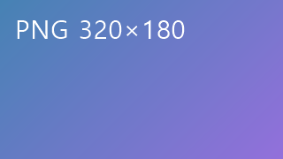
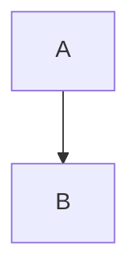

# 제목 1

## 제목 2

### 제목 3

#### 제목 4

##### 제목 5

###### 제목 6

문단에 **굵게**, *기울임*, ~~취소선~~, `인라인 코드`가 섞여 있다.
같은 문단의 둘째 줄이다.

***굵은 기울임***과 [링크](https://example.com "예시")와 <https://auto.example.com> 자동 링크.

줄 끝 역슬래시로\
강제 줄바꿈.

> 인용 첫 줄
>
> > 중첩 인용

---

- 비순서 항목 1
- 비순서 항목 2
  - 중첩 항목
    - 3단계 항목

3. 셋부터 시작
4. 넷

- [ ] 할 일
- [x] 끝난 일

```rust
fn main() {
    println!("안녕");
}
```

    들여쓰기 코드 블록

| 왼쪽 | 가운데 | 오른쪽 | 기본 |
| :--- | :---: | ---: | --- |
| a | **굵게** | `코드` | 1 |
| 한글 | 나 | 다 | 2 |



각주 참조[^1]와 이름 각주[^note].

[^1]: 첫 번째 각주.

[^note]: 이름 있는 각주.

<div align="center">
  <b>HTML 블록</b>
</div>

인라인 <kbd>Ctrl</kbd> HTML과 줄바꿈<br>태그.



## 제목 2
