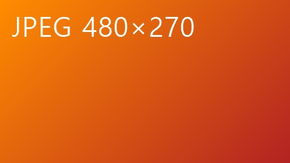
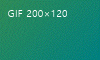
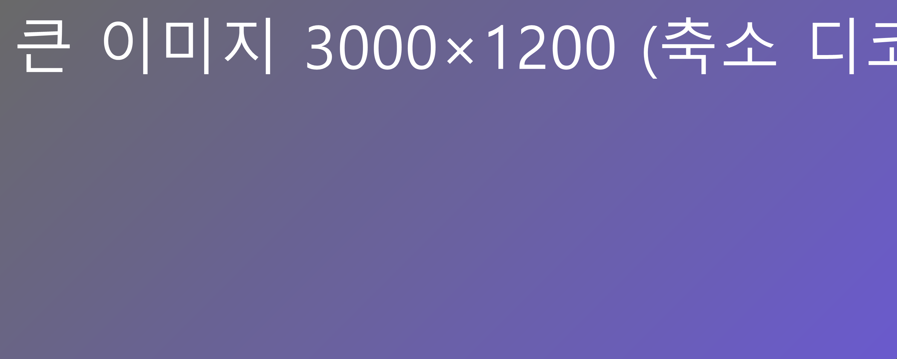

# 이미지·Front Matter·각주·기타 요소

위의 Front Matter는 접힌 메타데이터 블록으로 보여야 한다. 눌러서 펼칠 수 있다.

## 로컬 이미지

상대 경로 PNG:


JPEG, GIF(첫 프레임), SVG:






폭보다 큰 이미지는 보이는 폭에 맞춰 줄어든다 (디코딩도 긴 변 2048px로 축소):



## 표시할 수 없는 이미지

없는 파일:


원격 이미지 (기본 차단):


## 각주

본문에서 각주를 참조한다[^first]. 두 번째 각주[^second]도 있고, 첫 번째 각주를 다시 참조한다[^first].

번호를 누르면 아래 각주로 이동하고, 각주의 `↑ 본문으로`를 누르면 처음 참조한 곳으로 돌아온다.

## 원시 HTML

<div class="note">
  이 HTML 블록은 실행되지 않고 <b>원문 그대로</b> 회색으로 보인다.
</div>

인라인 <kbd>Ctrl</kbd>+<kbd>S</kbd> 태그도 원문으로 보이고, 줄바꿈 태그만<br>줄을 바꾼다.

## Mermaid와 수식


```math
E = mc^2
```

## 끝

각주로 이동했을 때 화면이 충분히 내려가도록 빈 문단을 둔다.

…

…

…

…

…

…

…

…

[^first]: 첫 번째 각주 내용. **굵게**와 `코드`도 쓸 수 있다.

[^second]: 두 번째 각주 내용.
